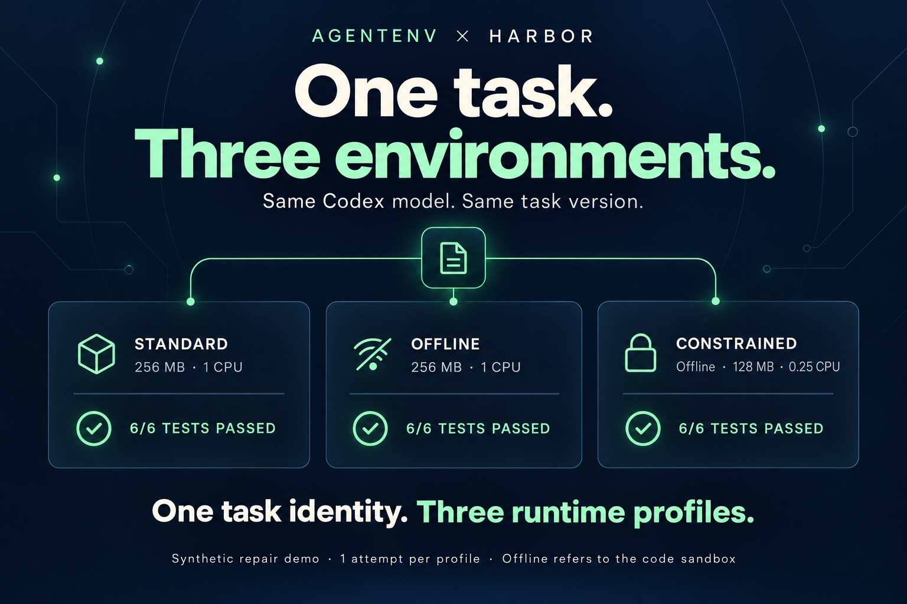

# AgentEnv × Harbor: one task, different environments

**Latest verified run:** real Codex with ChatGPT login repaired the task in all
three environments (3/3 rewards, six hidden tests passed per attempt). No API key.
See [verification and limits](VERIFIED.md) and [published results](evidence/results.json).



A real AgentEnv custom task step runs one Harbor-format repair exercise on
[psf/requests](https://github.com/psf/requests), pinned to commit
`0e322af87745eff34caffe4df68456ebc20d9068`. It deliberately breaks
case-insensitive header lookup. **This is a synthetic regression, not an
upstream bug, official Harbor dataset task, or model benchmark.**

## Run locally or on a Linux VM

Requirements: Python 3.11+, Docker, and network access for the initial image build.

```sh
git clone https://github.com/SimranS224/agentenv-harbor-demo.git
cd agentenv-harbor-demo
python3 -m venv .venv
source .venv/bin/activate
python -m pip install -r requirements.txt
bash run.sh all controls
```

Switch only the runtime profile; do not create another task:

```sh
bash run.sh standard
bash run.sh offline
bash run.sh constrained
```

Uses `agent-env` from PATH; override `AGENTENV_BIN` to select another installation.
Docker is required. The default scripted
controls need no API keys or paid model calls. AgentEnv's local state is isolated in this project's `.trial-state`.
The AgentEnv run can say **unscored**: task-step success means infrastructure
controls passed; the six individual binary verifier rewards are in the artifacts
and task context, not wired into an AgentEnv evaluation score.

## What this demonstrates

One immutable instruction + Dockerfile + tests + oracle → one AgentEnv task
step → runtime profiles → fresh container per attempt → same verifier → results.

| Profile | Runtime network | Memory | CPU |
|---|---|---:|---:|
| standard | Docker bridge | 256 MB | 1 |
| offline | none | 256 MB | 1 |
| constrained | none | 128 MB | 0.25 |

Every profile runs a no-op (expected reward 0), then a known scripted repair
(expected reward 1). Tests are copied only after the repair phase. Docker runtime
settings are inspected, task files are hashed before/after, and each container
is removed in a finally block. Builds require networking; offline means **trial
runtime**, not image build. Resource changes are environment variants, not new
task instructions. No claim about model robustness follows from these controls.

Inspect `artifacts/<run>/summary.md`, `results.json`, and per-attempt logs.
Open `artifacts/<run>/index.html` for a portable report with expandable evidence.
Tests: `python3 -m unittest -v test_runner test_model_agent test_codex_agent` (Python 3.11+). The real Docker integration
test uses a fake API transport and costs nothing:
`HARBOR_DOCKER_TEST=1 python3 -m unittest -v test_docker_integration`.

## Real coding agent with your ChatGPT login (no API key)

```sh
codex login
bash run.sh all codex
```

Requires Codex CLI installed and an existing ChatGPT `codex login` session.
Verified with `codex-cli 0.151.0`; the app-server protocol and model availability
can vary across releases/accounts. Preflight checks that the account
type is **chatgpt** and that `gpt-5.6-luna` is in its available model catalog.
All three attempts use that model at low reasoning effort and standard speed.
This consumes your ChatGPT/Codex allowance; exact dollar cost is not available.
It does not create an API key, buy credits, change billing settings, or fall
back to API-key authentication. The API spend ledger below is not used here.

Codex runs as a controller via its app-server stdio protocol. The agent receives
one dynamic tool, `sandbox_shell`, which the adapter executes as UID 65534 in
the selected Docker container. Native host environment access is disabled with
`environments: []`; built-in shell, browser, images, connectors, plugins, hooks,
memories and subagents are disabled. The internal code-mode dispatcher remains
enabled because this model needs it to call dynamic tools. Credentials stay
with the controller's normal Codex login; they are not read, copied, mounted or
passed to the task container. Thread history is ephemeral; the adapter keeps
the explicit trial trace as an artifact.

Each attempt gets 60 seconds after setup and at most 8 shell calls. At a usage
event reporting 32,000 cumulative tokens, the adapter interrupts; this is a
stop threshold, **not a hard token or billing cap**, because an in-flight model
response can exceed it. Input counts include repeated context; cached input
and output tokens are also recorded. The process is terminated after each trial.
No model retries are initiated by the adapter. There is one fresh conversation
and container per environment; no solution is shared between attempts.

The output includes an expandable command transcript, source patch, final
answer, token usage, observed resource settings, hidden verifier output and
container cleanup status. No native Harbor CLI is used.

## Optional API-key coding-agent experiment

```sh
# With OPENAI_API_KEY already exported in this shell:
bash run.sh all model
```

The same pinned `gpt-5.4-mini-2026-03-17` model, low reasoning, instruction,
shell tool, and limits run once per profile. The task files and bundle stay
unchanged. `HARBOR_DEMO_MODE` and `HARBOR_DEMO_PROFILE` are adapter runtime knobs;
the step also accepts AgentEnv's `step_params` overrides `mode` and `profile`.
The plain CLI `--model` is not used by this adapter: the model is deliberately
pinned for comparability and cost enforcement.

The agent has 8 model turns, 60 seconds, 2,048 output tokens per call, and a
32 KB serialized request limit. Shell commands run as UID 65534; only source
files and scratch space are writable. Candidate processes are stopped before
the hidden verifier is copied in. The controller keeps the API credential;
it never enters the container. Offline refers to sandbox network access,
not the remote model inference connection. No automatic API retries.

The persistent `.spend-ledger.json` shares a **$1 API allowance across reruns**.
Each request first reserves a conservative upper bound using serialized UTF-8
bytes plus 4,096 framing tokens and the maximum output. Returned usage settles
the reservation at uncached list prices ($0.75/M input, $4.50/M output), so
cached input makes the recorded cost conservative. Timeouts/crashes retain
the reservation. An exclusive lock prevents concurrent experiments. Do not
delete/reset the ledger to resume without choosing a new budget. VM charges
are separate. Prices were checked on 2026-10-13.

Artifacts include each model response, shell command/output, Python source
diff, observed Docker settings, verifier output, timing, usage and cost.
AgentEnv persists the report in task context under `harbor_environment_demo`.
Detailed traces remain in the artifact directory; this is not a native AgentEnv
trajectory/replay integration. Binary rewards are not wired into its eval score.

## What this showcases compared with Harbor alone

The benefit for an existing AgentEnv user is **workflow reuse**: a Harbor-format
exercise becomes an AgentEnv custom task step, with the same task registry,
runtime override seam and persisted run context as other workflows. One task
version can be exercised under multiple runtime profiles without editing it.

Harbor already runs coding agents, switches sandbox backends and logs rollouts.
The Docker matrix, spend ledger and HTML report here are custom adapter code,
not capabilities Harbor lacks. This demo does not execute Harbor CLI or prove
AgentEnv is faster or cheaper. Three single attempts on an easy synthetic task
are a smoke experiment, not a statistically meaningful robustness evaluation.

## Scope and next step

This adapter is a proof of concept for a single-container Dockerfile task,
shell oracle, and binary `/logs/verifier/reward.txt` contract. It is not a
universal Harbor importer: multi-container tasks, arbitrary task metadata,
remote sandbox backends, network-policy translation, and training
rollout exports are not implemented. It does not run the Harbor CLI.

Harbor already supports backend switching natively. AgentEnv adds orchestration
here through a custom task step and persisted run context; Docker is the actual
execution backend. The optional real-agent path above preserves tool traces and
compares rewards and cost within the authorized $1 experiment budget.

Never expose the Docker socket or run untrusted agents with host mounts. These
containers have no host mounts or secrets and have capabilities dropped, but
Docker is not a sufficient boundary for hostile multi-tenant code. A forced kill
of the controller can leave a container: inspect only names starting `ae-harbor-`
and remove the exact abandoned container. Image/build cache remains reusable.

References: [Harbor task format](https://docs.harborframework.com/tasks/overview),
[Requests source](https://github.com/psf/requests/tree/0e322af87745eff34caffe4df68456ebc20d9068),
[Harbor capabilities](https://github.com/harbor-framework/harbor),
[OpenAI model pricing](https://developers.openai.com/api/docs/models/gpt-5.4-mini).
