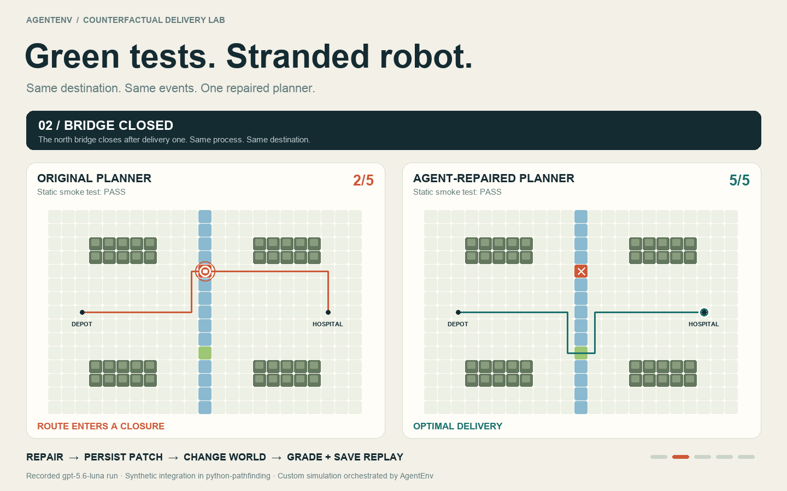

# Green tests. Stranded robot.

A small counterfactual delivery lab built on [python-pathfinding](https://github.com/brean/python-pathfinding).
The original planner passes a static smoke test. Then a bridge closes, floodwater
changes travel costs, both bridges close, and finally the roads reopen.
The same long-lived planner process must react correctly to each request.



[25-second video](sample/showcase.mp4) · [Interactive replay (download and open)](sample/index.html) · [Recorded routes and scores](sample/results.json) · [Actual Codex patch](sample/repair.patch)

## Actual result

One bounded `gpt-5.6-luna` coding attempt, using ChatGPT login rather than an API
key, repaired the demo integration. Both versions passed the static smoke test.

| World event | Original | Agent repair |
|---|---|---|
| All clear | Optimal route | Optimal route |
| North bridge closes | Enters closure | Reroutes via south bridge |
| North bank floods | Cost 96 | Optimal cost 30 |
| Both bridges close | Enters closure | Safe stop, no route |
| Roads reopen | Optimal route | Optimal route |

Original **2/5**; repaired **5/5**. Route legality and cost are checked against
an independent Dijkstra implementation outside the candidate container.
The animation interpolates recorded route coordinates; it is not a live robot
or a model playing the environment one frame at a time.

## What AgentEnv contributes

Three custom task steps run in a dependency graph:

1. **Repair:** bounded coding agent in an offline Docker sandbox; save the patch
   to AgentEnv's file-artifact store.
2. **Simulate:** run the original and repaired code through identical world events,
   preserving each planner's process between events; persist the verification score.
3. **Replay:** create a self-contained HTML replay and register it as a file artifact.

The CLI reported task **v1, unchanged**, completed 3/3 steps and grade **1.0**.
The persisted task context contains the patch, evidence, and replay artifact IDs.
This is a concrete coding-to-simulation workflow: static correctness is only the
first checkpoint; the useful output is behavior under interventions.

**Fair comparison:** this demo does not execute Harbor CLI, and these static tests
are not Harbor's own verifier. Harbor can run custom dynamic tests too. The benefit
shown here is composing the coding exercise, evolving-world evaluation, scoring,
and artifact collection within an existing AgentEnv workflow. The city simulation,
Docker adapter, event stream and renderer are custom code, not unique built-in
AgentEnv capabilities. No claim of superior model quality, cost or speed is made.

## Reproduce

Python 3.11+, Docker, and network access for the image build:

```sh
python3 -m venv .venv
source .venv/bin/activate
pip install -r requirements.txt
bash run.sh controls   # reference repair, no model usage
codex login            # requires Codex CLI and ChatGPT access
bash run.sh codex      # one model attempt, consumes plan allowance
```

The no-key adapter was verified with Codex CLI 0.151.0 and model `gpt-5.6-luna`.
Model availability and app-server compatibility can differ by account/version.
It permits 8 shell calls and 60 seconds, interrupting at the next cumulative
32,000-token usage event. This is a soft threshold, not a hard billing/token cap.
The successful run used 7 tool calls, 37,601 input tokens (20,224 cached), and
1,344 output tokens. It reached the token stop before a final answer; the saved
patch was independently evaluated afterward. No API-key fallback or API calls.
VM costs are separate. One attempt is not a statistical benchmark.

The sandbox has no network, no host mounts or controller credentials, 256 MB RAM,
1 CPU, dropped capabilities and an unprivileged coding-agent process. Model
inference remains outside it. Containers are removed in finally blocks. Docker
is not a hostile multi-tenant security boundary.

## Scope and validation

- Upstream pinned at `e8d3600ace29707912f1d92b7121e3ee99b4b580`.
- `rescue.py` is our deliberately faulty integration, **not an upstream bug**.
- The baseline cache keys only on endpoints. Codex removed caching and used the
  existing DijkstraFinder with a fresh grid per request.
- The five-event replay is deterministic. Road closure/flood changes occur between
  route requests, not halfway through a robot's physical movement.
- A scripted control reached 5/5 before the real coding-agent run.
- Three verifier unit tests passed; both scenario lanes ran in fresh offline
  containers through the actual AgentEnv CLI. Browser replay controls were checked.
- The first control run exposed an artifact-ID namespace error; it was corrected
  to use local artifact IDs before both successful runs. No model calls in that run.

Run `python -m unittest test_world`. Each run writes `artifacts/<run>/index.html`,
JSON evidence, source checkpoint, patch and the local tool trace. Published sample
results omit local controller identifiers. The optional `rescue_demo.movie` module
renders PNG frames using Pillow and macOS Arial fonts; the video is encoded using
FFmpeg at 8 fps. The HTML replay needs no external dependencies.
