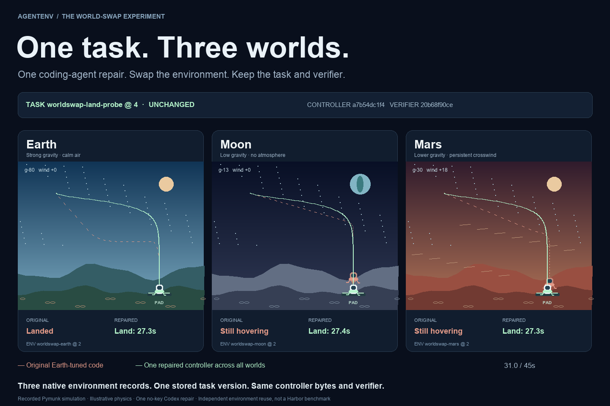

# One task. Three worlds.

A coding agent repairs a probe's autopilot once. AgentEnv then flies **the exact same controller artifact through three independently registered environments**, using **one stored task version and one verifier**.

[Watch the 24-second video](sample/showcase.mp4) · [Download the interactive replay](sample/index.html) · [Recorded evidence](sample/comparison.json) · [Agent's patch](sample/repair.patch)



Built on [Pymunk](https://github.com/viblo/pymunk) 7.3.0. These are recorded physics trajectories, rendered into an interactive replay and a video. The deliberately Earth-tuned original lands on Earth but hovers on Moon and Mars. The repaired controller compensates for gravity and wind and lands in all three.

| World | Original | Same repaired controller |
| --- | --- | --- |
| Earth | Landed | Landed in 27.3 s |
| Moon | Timeout, hovering | Landed in 27.4 s |
| Mars + crosswind | Timeout, hovering | Landed in 27.3 s |

## What this demonstrates

Each world is a separate native AgentEnv `Env` record, implemented by this demo's `PhysicsWorld` plugin. The task uses the built-in `deploy_env` step with `env_id: "<world_id>"`. Only the seed's `world_id` changes between runs. Custom steps load a pinned controller `FileArtifact`, fly it, apply the shared landing contract, and save trajectories as another native `FileArtifact`.

The captured batch uses task `worldswap-land-probe@4`, controller `worldswap-controller@4`, and three environment records at version 2. Task versions 1–3 were development iterations, not separate versions for different worlds. The collector verifies task definition hashes before/after, native task instance versions, controller bytes/version, verifier bytes, and deployed world definitions. The replay exposes these records in its proof panel.

This makes environment reuse concrete: a new world can be registered independently and selected when running the existing task. [AgentEnv's task parameters](https://www.agentenvframework.com/docs/tasks/creating) provide the substitution mechanism.

The fair Harbor comparison is architectural. [Harbor's standard task format](https://github.com/harbor-framework/harbor/blob/main/docs/content/docs/tasks/index.mdx) bundles instructions, environment setup, and tests. Harbor also supports multiple backends and custom/parameterized setups; this demo does **not** establish that Harbor must create a new task for every environment, or measure performance against Harbor. It shows AgentEnv's explicit, independently versioned task/environment/artifact composition.

## Run it

Prerequisites: Python 3.12, Docker, and the pinned Python packages. Tested on Linux with AgentEnv 0.9.1324 / protocol 0.1.339. Docker must be able to build the Pymunk image; flight containers run without networking. The Python base image tag is mutable; the captured environment definitions record the resolved built image ID.

```sh
python3 -m venv .venv
. .venv/bin/activate
pip install -r requirements.txt
bash run.sh controls
python3 -m http.server 4193 --bind 127.0.0.1 --directory artifacts
```

Open `http://127.0.0.1:4193`. `controls` uses a small scripted reference repair and makes no model calls. The included `sample/index.html` also works as a standalone downloaded file without installing anything.

For a fresh real coding repair, install the official Codex CLI, sign in with your ChatGPT account, then run `bash run.sh codex`. The captured run used Codex CLI 0.151.0 and `gpt-5.6-luna`. Model availability depends on your account. It allows one attempt, 8 shell calls, 60 seconds, and an interrupt at the next usage event after 32k cumulative tokens (a soft threshold). There is no API-key fallback. ChatGPT allowance and any machine/VM cost still apply.

`run.sh` prepares/registers once, then executes three runs of the same resulting task version. Invoking the entire script again creates a fresh controller/task version. To swap only a world after registration, keep the existing stores/config and invoke the CLI with the existing version:

```sh
export PYTHONPATH="$PWD"
export XDG_STATE_HOME="$PWD/.trial-state"
export AGENT_ENV_CONFIG="$PWD/.agentenv/config.toml"
# Replace VERSION with artifacts/registry.json's task_version.
agent-env task run --id worldswap-land-probe --version VERSION \
  --context-json artifacts/seed-moon.json --output-dir artifacts/extra-run
```

The three measured runs require no further model inference. The one-time repair happens before the reusable landing task; the agent sees all three world configurations and can test them.

## Evidence and limits

The real coding attempt completed in 5 shell calls: 30,220 input tokens (9,472 cached) and 1,492 output tokens. No API key was used; dollar cost is unavailable. Infrastructure/control runs preceded this attempt. The final audit reran physics without another model call.

The shared verifier requires first ground contact within 45 seconds, horizontal pad error ≤12, horizontal speed ≤8, and vertical speed ≤12. Four contract tests cover a valid landing, wrong pad, hard impact, and hovering (`python3 -m unittest test_contract`). The repaired controller is not faster or softer than the original Earth landing; the improvement is success across the three worlds.

This is a small deterministic integration demo, not an unseen-world generalization benchmark. The fixed-angle, two-axis probe uses illustrative gravity/wind values rather than physically accurate planetary models. The bug is in our demo controller, not upstream Pymunk. The custom Env/steps are included here, not built-in Pymunk support in AgentEnv.

To regenerate the video, install Pillow, run `python3 -m lander_demo.movie`, then encode `artifacts/frames/%04d.png` at 10 fps with ffmpeg (H.264, yuv420p). The replay uses actual sampled positions; decorative scenery is illustrative.
